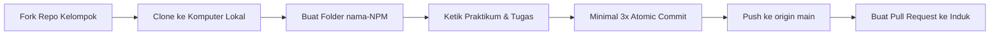

# 🚀 Panduan Praktikum: Python Lanjutan & Kolaborasi GitHub

[](https://www.python.org/)
[](https://git-scm.com/)
[](https://github.com/)
[](https://code.visualstudio.com/)

Selamat datang di repositori resmi praktikum **Python Lanjutan & Alur Kerja Kolaborasi GitHub**! Repositori ini disusun sebagai panduan praktikum interaktif yang menggabungkan penguasaan logika pemrograman Python dengan praktik alur kerja Git standar industri (*fork*, *branch*, *atomic commit*, dan *pull request*).

---

## 📖 Lembar Panduan & Cheat Sheet
Seluruh instruksi detail, materi, dan kode sumber latihan telah disiapkan dalam dokumen khusus:

👉 **[Buka Dokumen Cheat Sheet Praktikum](cheat-sheet.md)** 👈

> [!CAUTION]
> ### 🛑 TATA TERTIB & PERINGATAN RESMI: DILARANG CURI START!
> 1. **Kode Disembunyikan**: Seluruh kode latihan praktikum dan tugas mandiri di dalam [cheat-sheet.md](cheat-sheet.md) telah **dikunci dan disembunyikan** di balik menu lipat (*collapsible drop-down*).
> 2. **Tunggu Aba-Aba**: **DILARANG KERAS** membuka menu lipat atau mengetik kode praktikum sebelum ada instruksi resmi dari dosen/pemateri di depan kelas!
> 3. **Pahami Analogi & Logika**: Setiap sesi dibuka dengan penjelasan cara kerja logika kode menggunakan analogi visual di layar. Fokuslah pada fondasi berpikir komputasional.
> 4. **Ketik Mandiri (*Muscle Memory*)**: Ketik kode secara langsung pada teks editor kalian. Hindari jalan pintas *copy-paste* agar terbiasa dengan sintaks dan penataan indentasi 4 spasi pada Python.

---

## 🎯 Ringkasan Materi Praktikum

| No | Modul / Praktikum | Berkas Target | Topik Bahasan |
|:---:|:---|:---|:---|
| 1 | **Praktikum 1** | `praktikum_01.py` | *Nested If* (Evaluasi Kehadiran & Nilai Kelulusan) |
| 2 | **Praktikum 2** | `praktikum_02.py` | Pengujian Bilangan Prima, Operator Modulus (`%`), dan `break` |
| 3 | **Praktikum 3** | `praktikum_03.py` | Deret Aritmatika, Akumulator Nilai, dan Cetak Baris (`end=" "`) |
| 4 | **Praktikum 4** | `praktikum_04.py` | Matriks 2D (*Nested Loop*) & Pengenalan Manipulasi `list` |
| 5 | **Tugas Mandiri 1** | `operasi3.py` | Modul Fungsi Matematika Kustom |
| 6 | **Tugas Mandiri 2** | `tugas3_menu.py` | Aplikasi Konsol Interaktif Berbasis Menu (`while True`) |

---

## 📁 Struktur Folder Wajib Mahasiswa

Setiap mahasiswa wajib membuat satu folder kerja pribadi di dalam repositori hasil *fork* dengan format penamaan **`nama-NPM`** (huruf kecil semua, dipisahkan tanda strip):

```text
tugas-minggu-2/
└── ahmad-2610001/             <-- Ganti dengan nama panggilan dan NPM kalian
    ├── .gitignore             <-- Berkas pengabaian file sampah & virtual env
    ├── README.md              <-- Berkas identitas pribadi & catatan pengerjaan
    ├── praktikum_01.py        <-- Latihan Nested If
    ├── praktikum_02.py        <-- Latihan Prima & Modulus
    ├── praktikum_03.py        <-- Latihan Deret & Akumulator
    ├── praktikum_04.py        <-- Latihan Matriks & List
    ├── operasi3.py            <-- Modul Fungsi Matematika (Tugas Mandiri)
    └── tugas3_menu.py         <-- Program Utama Menu Konsol (Tugas Mandiri)
```

> [!IMPORTANT]
> Pastikan struktur penamaan berkas persis seperti di atas untuk memudahkan verifikasi otomatis dan penilaian oleh tim pengajar.

---

## 🛠️ Prasyarat & Persiapan Lingkungan

Pastikan perangkat kalian telah terpasang perangkat lunak berikut sebelum praktikum dimulai:

1. **Python 3.10+**: Periksa via terminal dengan `python --version` atau `python3 --version`.
2. **Git**: Pastikan konfigurasi nama dan email lokal sudah sesuai akun GitHub:
   ```bash
   git config --global user.name "Nama Lengkap Kalian"
   git config --global user.email "email_kalian@domain.com"
   ```
3. **Visual Studio Code**: Disarankan memasang ekstensi resmi:
   - *Python* (oleh Microsoft)
   - *Pylance*

---

## ⚡ Cara Menjalankan Berkas Python

Buka terminal pada direktori folder kerja kalian (`ahmad-2610001/`), lalu jalankan file yang diinginkan:

```bash
# Menjalankan Praktikum 1
python praktikum_01.py

# Menjalankan Praktikum 2
python praktikum_02.py

# Menjalankan Praktikum 3
python praktikum_03.py

# Menjalankan Praktikum 4
python praktikum_04.py

# Menjalankan Program Tugas Mandiri
python tugas3_menu.py
```

---

## 📤 Alur Pengumpulan ke GitHub (Ringkas)

Alur lengkap beserta penjelasan perintah dapat dibaca di **[cheat-sheet.md](cheat-sheet.md#-panduan-alur-pengumpulan-tugas-ke-github)**.



Format judul Pull Request resmi:
```text
Nama Lengkap - NPM - Tugas Minggu 2
```

---

<div align="center">
  <sub>© Tim Dosen & Asisten Laboratorium Praktikum • Dibuat dengan dedikasi untuk pengalaman belajar terbaik</sub>
</div>
