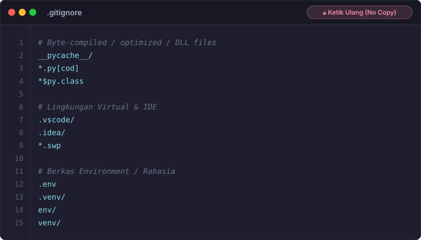
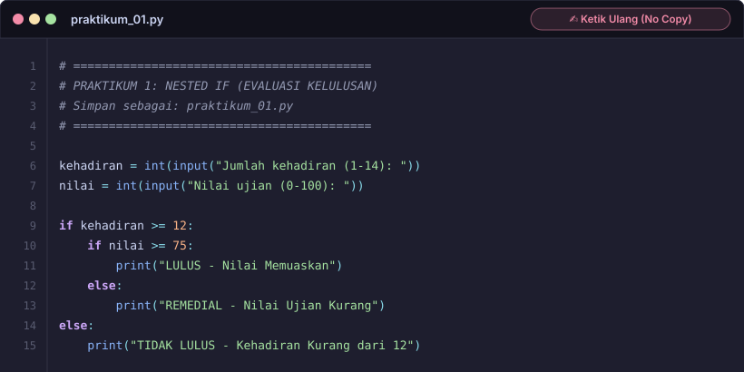
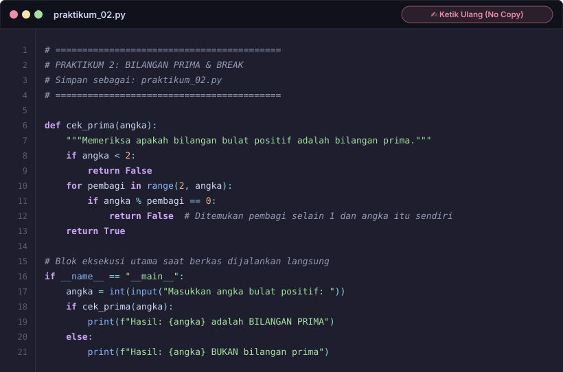
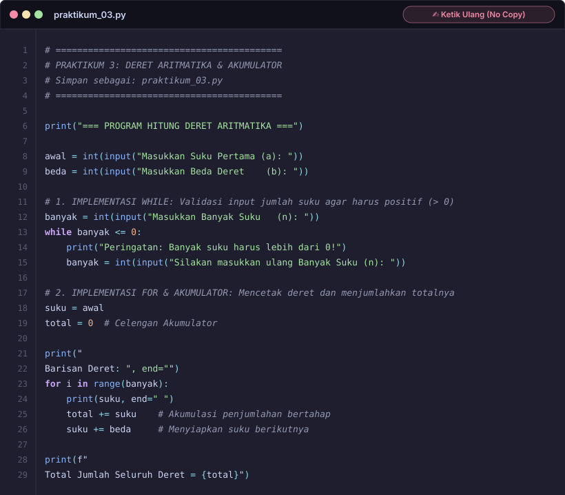
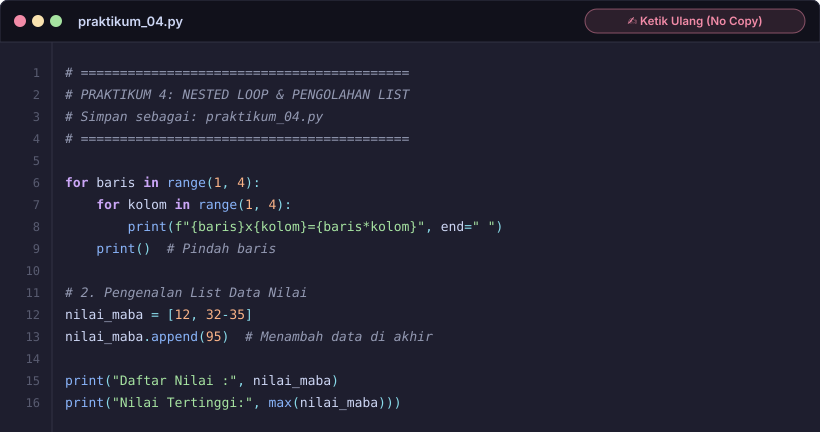
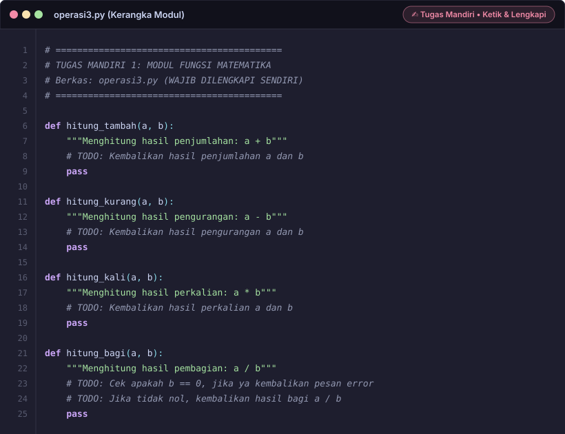
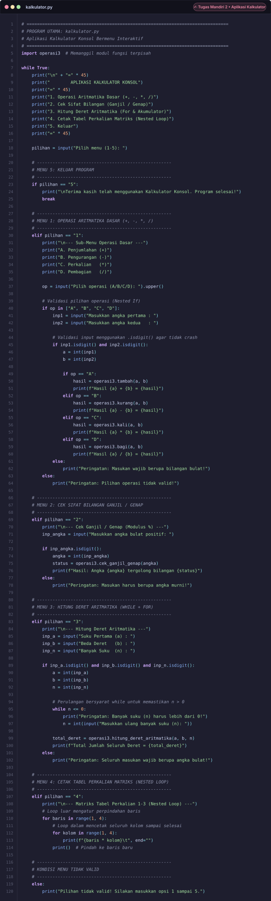

# 📖 Cheat Sheet Praktikum: Python Lanjutan & Kolaborasi GitHub

Selamat datang di lembar contekan (*cheat sheet*) resmi praktikum **Python Lanjutan & Kolaborasi GitHub**.

> [!CAUTION]
> ### 🛑 TATA TERTIB RESMI: DILARANG CURI START & SALIN OTOMATIS!
> Seluruh kode praktikum dan tugas mandiri di bawah ini telah dikunci dan disajikan dalam format **Visual Code Card (SVG)**:
> 1. **Tombol Salin Ditiadakan**: Tidak ada tombol *copy/salin* otomatis di halaman ini. Setiap kode **wajib diketik ulang secara manual (*tulis ulang*)** ke dalam teks editor (VS Code) untuk melatih pemahaman sintaksis dan *muscle memory*.
> 2. **Tugas Mandiri (operasi3.py & kalkulator.py)**: Terdiri dari modul fungsi logika & matematika mandiri (`operasi3.py`) dan aplikasi kalkulator konsol bermenu interaktif (`kalkulator.py`) yang mengimpor modul tersebut serta mengimplementasikan validasi input dan nested loop.
> 3. **Tunggu Instruksi Pemateri**: Buka menu lipat (*accordion*) hanya saat sesi modul tersebut resmi dipandu oleh dosen/asisten di depan kelas.

---

## 📑 Navigasi Modul Praktikum
Gunakan tautan di bawah ini untuk melompat langsung ke sesi yang sedang berlangsung:

- [1. Konfigurasi Berkas `.gitignore`](#1-konfigurasi-berkas-gitignore)
- [2. Praktikum 1: Nested If - Evaluasi Kelulusan](#2-praktikum-1-nested-if-evaluasi-kelulusan) (`praktikum_01.py`)
- [3. Praktikum 2: Bilangan Prima & Break](#3-praktikum-2-bilangan-prima--break) (`praktikum_02.py`)
- [4. Praktikum 3: Deret Aritmatika & Akumulator](#4-praktikum-3-deret-aritmatika--akumulator) (`praktikum_03.py`)
- [5. Praktikum 4: Nested Loop & Manipulasi List](#5-praktikum-4-nested-loop--manipulasi-list) (`praktikum_04.py`)
- [6. Tugas Mandiri: Kalkulator Konsol Bermenu & Modul Operasi](#6-tugas-mandiri-kalkulator-konsol-bermenu--modul-operasi) (`operasi3.py` & `kalkulator.py`)
- [7. Panduan Pengumpulan Tugas ke GitHub](#7-panduan-alur-pengumpulan-tugas-ke-github)

---

## 1. Konfigurasi Berkas `.gitignore`
Pastikan berkas `.gitignore` diletakkan di dalam folder kerja mahasiswa kalian agar file-file sampah (*cache*) Python dan konfigurasi IDE tidak ikut terunggah ke repositori GitHub.

<details>
<summary><b>🔒 [KLIK UNTUK MELIHAT TEMPLATE] Berkas <code>.gitignore</code></b></summary>

<br>

> ✍️ **Instruksi:** Ketik isi berkas di bawah ini ke dalam file bernama `.gitignore` pada folder kerja kalian.

<div align="center">
  
</div>

<br>

#### 💡 Poin Penjelasan Berkas:
1. `__pycache__/` & `*.pyc`: Berkas *bytecode* sementara hasil kompilasi internal Python saat modul dijalankan.
2. `.vscode/` & `.idea/`: Berkas preferensi lokal milik teks editor pengguna yang tidak boleh mengotori repositori tim.
3. `.env` & `.venv/`: Berisi kredensial rahasia dan pustaka lingkungan virtual (*virtual environment*).

</details>

---

## 2. Praktikum 1: Nested If (Evaluasi Kelulusan)
* **Target File:** `praktikum_01.py`
* **Konsep Inti:** Percabangan Bersarang (*Nested If*), Gerbang Validasi Berlapis (Kehadiran $\rightarrow$ Nilai), serta Fungsi Modular yang dapat dipanggil kembali oleh menu tugas mandiri.

<details>
<summary><b>🔒 [KLIK UNTUK MEMBUKA KODE] Praktikum 1: Nested If</b></summary>

<br>

> ⚠️ **Peringatan:** Buka hanya saat pemateri menginstruksikan Praktikum 1 dimulai!  
> ✍️ **Ketik Ulang Manual:** Tombol salin ditiadakan. Ketik baris demi baris ke dalam `praktikum_01.py`.

<div align="center">
  
</div>

<br>

#### 💡 Poin Pembahasan Logika:
1. **Fungsi Modular `evaluasi_kelulusan(kehadiran, nilai)`**: Mengembalikan status kelulusan dalam bentuk *string*. Konsep modularisasi ini memisahkan logika pemrosesan dari antarmuka interaktif.
2. **Pintu Luar (`if kehadiran >= 12`)**: Berfungsi sebagai penyaring utama. Jika mahasiswa tidak memenuhi syarat kehadiran minimum, kondisi nilai ujian sama sekali tidak diperiksa.
3. **Pintu Dalam (`if nilai >= 75`)**: Berjalan di dalam blok `if` pertama untuk menentukan apakah mahasiswa lulus memuaskan atau harus remedial.
4. **Blok `if __name__ == "__main__":`**: Memastikan kode masukan interaktif hanya dijalankan ketika file `praktikum_01.py` dieksekusi langsung, dan tidak otomatis meminta input saat modul diimpor oleh tugas mandiri.

</details>

---

## 3. Praktikum 2: Bilangan Prima & Break
* **Target File:** `praktikum_02.py`
* **Konsep Inti:** Perulangan `for`, Operator Modulus (`%`), Pengujian Pembagi, dan Pernyataan `break` / Pengembalian Nilai Cepat (*Early Return*).

<details>
<summary><b>🔒 [KLIK UNTUK MEMBUKA KODE] Praktikum 2: Bilangan Prima & Break</b></summary>

<br>

> ⚠️ **Peringatan:** Buka hanya saat pemateri menginstruksikan Praktikum 2 dimulai!  
> ✍️ **Ketik Ulang Manual:** Tombol salin ditiadakan. Ketik baris demi baris ke dalam `praktikum_02.py`.

<div align="center">
  
</div>

<br>

#### 💡 Poin Pembahasan Logika:
1. **Fungsi Modular `cek_prima(angka)`**: Mengembalikan nilai *boolean* (`True` jika prima, `False` jika bukan).
2. **Eliminasi Cepat Angka $< 2$**: Angka kurang dari 2 (seperti bilangan negatif, 0, dan 1) secara matematis bukan bilangan prima.
3. **Optimasi Berhenti Cepat (*Early Exit*)**: Begitu ditemukan satu saja angka pembagi dengan sisa bagi nol (`angka % pembagi == 0`), fungsi langsung mengembalikan `False` detik itu juga tanpa menghabiskan siklus CPU.

</details>

---

## 4. Praktikum 3: Deret Aritmatika & Akumulator
* **Target File:** `praktikum_03.py`
* **Konsep Inti:** Pola Penjumlahan Berulang (*Accumulator Pattern*), Penambahan Beda Deret, Pengumpulan Elemen Deret, dan Pengembalian Multi-Nilai (*Tuple Return*).

<details>
<summary><b>🔒 [KLIK UNTUK MEMBUKA KODE] Praktikum 3: Deret & Akumulator</b></summary>

<br>

> ⚠️ **Peringatan:** Buka hanya saat pemateri menginstruksikan Praktikum 3 dimulai!  
> ✍️ **Ketik Ulang Manual:** Tombol salin ditiadakan. Ketik baris demi baris ke dalam `praktikum_03.py`.

<div align="center">
  
</div>

<br>

#### 💡 Poin Pembahasan Logika:
1. **Fungsi Modular `hitung_deret(awal, beda, banyak)`**: Mengembalikan dua luaran sekaligus: susunan elemen deret dalam wadah `list` dan angka total akumulasi penjumlahan (`total`).
2. **Pola Akumulator (`total += suku`)**: Diibaratkan seperti celengan yang setiap putaran iterasi terus dimasukkan nilai suku terbaru.
3. **Penyusunan Output String (`" ".join(...)`)**: Menggabungkan seluruh suku deret menjadi satu baris teks rapi yang dipisahkan oleh spasi.

</details>

---

## 5. Praktikum 4: Nested Loop & Manipulasi List
* **Target File:** `praktikum_04.py`
* **Konsep Inti:** Perulangan Bersarang (*Nested Loop 2D*), Karakter Tabulasi (`\t`), Struktur Data `list`, Penambahan Data `.append()`, dan Fungsi Agregasi `max()`.

<details>
<summary><b>🔒 [KLIK UNTUK MEMBUKA KODE] Praktikum 4: Nested Loop & List</b></summary>

<br>

> ⚠️ **Peringatan:** Buka hanya saat pemateri menginstruksikan Praktikum 4 dimulai!  
> ✍️ **Ketik Ulang Manual:** Tombol salin ditiadakan. Ketik baris demi baris ke dalam `praktikum_04.py`.

<div align="center">
  
</div>

<br>

#### 💡 Poin Pembahasan Logika:
1. **Fungsi `buat_matriks_perkalian(ukuran)`**: Menggunakan perulangan bersarang (*nested loop* 2D) untuk mencetak matriks tabel perkalian secara horizontal dan vertikal.
2. **Karakter Tabulasi `\t`**: Menjaga perataan kolom tabel matriks agar terlihat lurus dan simetris di layar terminal.
3. **Fungsi `analisis_list(daftar_nilai)`**: Memanfaatkan fungsi bawaan Python `max()` untuk mencari nilai tertinggi dalam suatu wadah data `list` tanpa perlu melakukan loop manual.

</details>

---

## 6. Tugas Mandiri: Kalkulator Konsol Bermenu & Modul Operasi

> [!IMPORTANT]
> ### 🚨 MODUL TUGAS MANDIRI
> Tugas mandiri terdiri dari **2 berkas** yang saling terhubung:
> 1. `operasi3.py`: Modul logika dan fungsi matematika murni (tanpa antarmuka input/print langsung).
> 2. `kalkulator.py`: Program utama kalkulator konsol interaktif bermenu (`while True`) yang mengimpor (`import operasi3`), menjalankan *nested loop*, serta memvalidasi masukan menggunakan `.isdigit()`.

Tugas mandiri terdiri dari **2 berkas** yang harus kalian selesaikan:

---

### 📦 Berkas 1: Modul Logika & Fungsi Matematika (`operasi3.py`)
Modul fungsi mandiri (`def`) dengan nilai kembalian (`return`) murni tanpa antarmuka input/print langsung.

<details>
<summary><b>🔒 [KLIK UNTUK MELIHAT KODE] Modul: operasi3.py</b></summary>

<br>

> ✍️ **Instruksi:** Buat berkas `operasi3.py`, ketik kode fungsi matematika mandiri di bawah ini secara teliti.

<div align="center">
  
</div>

<br>

#### 📋 Spesifikasi Fungsi Mandiri `operasi3.py`:
1. `tambah(a, b)`: Mengembalikan hasil penjumlahan $a + b$.
2. `kurang(a, b)`: Mengembalikan hasil pengurangan $a - b$.
3. `kali(a, b)`: Mengembalikan hasil perkalian $a \times b$.
4. `bagi(a, b)`: Mengembalikan hasil pembagian $a / b$. Menangani pencegahan error saat pembagi bernilai nol (`"Error: Pembagi tidak boleh bernilai nol!"`).
5. `cek_ganjil_genap(angka)`: Memeriksa sifat bilangan ganjil atau genap menggunakan operator modulus (`%`), mengembalikan `"GENAP"` atau `"GANJIL"`.
6. `hitung_deret_aritmatika(awal, beda, n)`: Menghitung total akumulasi deret menggunakan perulangan `for`.

</details>

---

### 💻 Berkas 2: Program Utama Konsol Bermenu (`kalkulator.py`)
Program aplikasi kalkulator konsol bermenu interaktif berbasis `while True` yang memanggil modul `operasi3`.

<details>
<summary><b>🔒 [KLIK UNTUK MELIHAT KODE] Berkas Utama: kalkulator.py</b></summary>

<br>

> ✍️ **Instruksi:** Buat berkas `kalkulator.py`, ketik kode program utama di bawah ini, pastikan modul `operasi3.py` berada pada direktori yang sama!

<div align="center">
  
</div>

<br>

#### 📋 Spesifikasi Fitur Menu `kalkulator.py`:
* **Menu 1 (Operasi Aritmatika Dasar)**: Menampilkan sub-menu operasi (A: Penjumlahan, B: Pengurangan, C: Perkalian, D: Pembagian). Menggunakan validasi `.isdigit()` dan memanggil fungsi `tambah`, `kurang`, `kali`, atau `bagi` dari `operasi3`.
* **Menu 2 (Cek Sifat Bilangan)**: Menerima input bilangan bulat positif, memvalidasi dengan `.isdigit()`, dan memanggil `operasi3.cek_ganjil_genap(angka)`.
* **Menu 3 (Hitung Deret Aritmatika)**: Menerima suku pertama ($a$), beda deret ($b$), dan banyak suku ($n$). Menerapkan perulangan bersyarat `while n <= 0` untuk validasi, lalu memanggil `operasi3.hitung_deret_aritmatika(a, b, n)`.
* **Menu 4 (Cetak Tabel Perkalian Matriks)**: Menjalankan perulangan bersarang (*nested loop*) baris 1–3 dan kolom 1–3 untuk mencetak tabel perkalian matriks.
* **Menu 5 (Keluar)**: Mencetak pesan terima kasih dan menghentikan perulangan program dengan `break`.
* **Validasi Pilihan**: Menampilkan pesan peringatan jika pilihan di luar rentang menu 1 sampai 5.

</details>

---

## 7. Panduan Alur Pengumpulan Tugas ke GitHub

Ikuti tahapan alur Git di bawah ini secara disiplin untuk mengumpulkan hasil praktikum dan tugas mandiri:

<details>
<summary><b>🚀 [KLIK UNTUK MELIHAT LANGKAH KERJA GIT & PENGUMPULAN]</b></summary>

<br>

### Langkah 1: Fork Repositori
1. Buka repositori `tugas-minggu-2` milik organisasi kelompok di GitHub.
2. Klik tombol **Fork** di pojok kanan atas untuk menduplikasi repositori ke akun GitHub pribadi kalian.

---

### Langkah 2: Clone ke Komputer Lokal
Jalankan perintah berikut di terminal (*Command Prompt / PowerShell / Git Bash*):
```bash
git clone https://github.com/USERNAME-KAMU/tugas-minggu-2.git
cd tugas-minggu-2
```

---

### Langkah 3: Buat Folder Pribadi Sesuai Format
Buat direktori baru dengan format `nama-NPM`:
```bash
mkdir ahmad-2610001
cd ahmad-2610001
```
> *Ganti `ahmad-2610001` dengan nama panggilan dan NPM resmi kalian.*

Pastikan seluruh berkas praktikum dan tugas mandiri berada lengkap di dalam folder tersebut:
- `.gitignore`
- `README.md`
- `praktikum_01.py`
- `praktikum_02.py`
- `praktikum_03.py`
- `praktikum_04.py`
- `operasi3.py`
- `tugas3_menu.py` (atau `kalkulator.py`)

#### 📝 Format Wajib Isi `README.md` Mahasiswa:
Buat dan lengkapi berkas `README.md` di dalam folder kerja kalian persis mengikuti format berikut:

````markdown
# Tugas Minggu 2 - Pelatihan Python Lanjutan & GitHub

- **Nama**     : [Nama Lengkap]
- **NPM**      : [NPM Mahasiswa]
- **Kelompok** : [Nomor Kelompok]

## Daftar Berkas
1. `praktikum_01.py` : Latihan Percabangan Bertingkat (Nested If)
2. `praktikum_02.py` : Latihan Deteksi Bilangan Prima & Modulus
3. `praktikum_03.py` : Latihan Deret Aritmatika & Akumulator
4. `praktikum_04.py` : Latihan Matriks Perkalian & List
5. `operasi3.py`     : Modul Operasi Matematika
6. `tugas3_menu.py`  : Aplikasi Konsol Utama Kalkulator
````

---

### Langkah 4: Lakukan Commit Bertahap (Minimal 3 Commit)
Disiplin riwayat *commit* menjadi penilaian kolaborasi. Jangan melakukan satu commit borongan sekaligus!

```bash
# Commit 1: Menambahkan latihan praktikum 1-4 yang sudah diselesaikan
git add praktikum_*.py
git commit -m "feat: menyelesaikan modul latihan praktikum 1 sampai 4"

# Commit 2: Menambahkan modul operasi matematika & aplikasi kalkulator konsol
git add operasi3.py kalkulator.py
git commit -m "feat: menyelesaikan modul kalkulator dan program menu terpadu"

# Commit 3: Menambahkan identitas diri dan konfigurasi gitignore
git add README.md .gitignore
git commit -m "docs: melengkapi dokumentasi pengerjaan dan konfigurasi gitignore"
```

---

### Langkah 5: Push ke Repositori Fork
Unggah seluruh perubahan lokal ke branch utama GitHub pribadi kalian:
```bash
git push origin main
```

---

### Langkah 6: Ajukan Pull Request (PR)
1. Buka kembali halaman repositori fork kalian di GitHub.
2. Klik tombol **Contribute** $\rightarrow$ **Open Pull Request**.
3. Pastikan *base repository* mengarah ke repositori induk organisasi.
4. Gunakan format judul Pull Request:
   ```text
   Nama Lengkap - NPM - Tugas Minggu 2
   ```
5. Isi deskripsi PR dengan ringkasan tugas yang telah diselesaikan, lalu klik **Create Pull Request**.

</details>

---

<div align="center">
  <sub>Praktikum Python Lanjutan & Kolaborasi GitHub • Panduan Resmi Laboratorium Terpadu</sub>
</div>